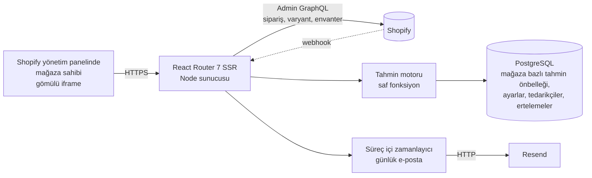

# Inventory Forecast (Envanter Tahmini)

**Shopify mağazaları için stok tükenme tahmini ve sipariş planlama uygulaması.** Mağaza sahibine hangi ürünlerin ne zaman biteceğini, siparişi ne zamana kadar vermesi gerektiğini ve kaç adet alması gerektiğini söyler; her sayının arkasındaki hesabı da gösterir.

    

> **Durum:** Özellikleri tamamlandı ve gerçek bir Shopify geliştirme mağazasında (~250 ürün, sentetik sipariş geçmişi) uçtan uca doğrulandı.

---

## Neyi cevaplar

Her ürün varyantı için üç soruyu yanıtlar:

1. **Ne zaman biter?**
2. **Siparişi ne zaman vermeliyim?** (tedarikçimin teslim süresi göz önüne alınarak)
3. **Kaç adet almalıyım?**

### Örnek

Stokta 12 adet olan, günde yaklaşık 1,5 adet satılan, tedarik süresi 30 gün ve kapsama hedefi 20 gün olan bir ürün:

| Soru | Cevap | Hesap |
|---|---|---|
| Ne zaman biter | **8 gün sonra** | 12 ÷ 1,5 |
| Sipariş için son gün | **22 gün önce** (süre geçmiş) | 8 − 30 |
| Önerilen miktar | **63 adet** | 1,5 × (30 + 20) − 12 |

Bu sayıların her biri uygulamada görünür; "kara kutu" bir puanın arkasına saklanmaz.

---

## Özellikler

**Pano**
- Her ürün beş kategoriden birine ayrılır: *Stok bitti*, *Azalıyor*, *Stok yeterli*, *Satılmıyor*, *Tahmin yok*; ayrıca bir *En çok satanlar* görünümü vardır. Özet kartları aynı zamanda filtre görevi görür.
- Arama, sayfalama, erteleme (7 / 30 / 90 gün veya süresiz), trend okları ve tahmin az veriye dayanıyorsa güven notu.
- Ürün bazında tedarik süresi, tablonun içinde satır içi düzenlenebilir.
- Hazır ayarlarla Excel'e aktarma: mevcut görünüm, tüm ürünler, "bugün sipariş verilecekler".

**Ürün detay sayfası**
- Son 12 haftanın satış geçmişi ve stok tükenme projeksiyonu; ikisi de elle yazılmış SVG ile çizilir (grafik kütüphanesi yok).
- Açık formüllü sağlık skoru (0–100) ve lokasyon bazında stok dağılımı.
- Önerilen miktarın arkasındaki her girdiyi listeleyen hesap paneli.
- Birbirinden bağımsız 14 / 30 / 60 / 90 günlük tahminler ve büyüme simülatörü (−%75 ile +%200 arası kaydırıcı).

**Operasyon**
- Kendi tedarik süresi olan tedarikçi kayıtları. Bir tedarikçiyi düzenlemek, ona atanmış tüm ürünleri günceller.
- Neyin bittiğini ve neyin sipariş edilmesi gerektiğini özetleyen günlük e-posta.
- **Tahmin karnesi:** uygulama kendi tahminlerini gerçekte satılanla karşılaştırıp not verir (aşağıda).

**Platform**
- Shopify yönetim panelinin içine gömülü (App Bridge), telefon genişliğine kadar duyarlı.
- Türkçe ve İngilizce arayüz (yaklaşık 270 tipli çeviri anahtarı); dil, Shopify'ın ilettiği `locale` değerinden seçilir.
- Pano, detay ve ayarlar sayfaları için ilk kullanımda gösterilen spot ışığı turları.
- Akışlı (streaming) pano: Shopify senkronizasyonu sürerken sayfa iskeleti ve yükleme ekranı hemen gelir.

---

## Tahmin nasıl çalışır

Motor `app/lib/forecast.ts` dosyasındadır ve **saf bir fonksiyondur** (girdi: satış anlık görüntüsü, çıktı: varyant başına tahmin). Hiçbir API çağrısı yapmaz, bu yüzden Shopify olmadan da çalıştırılabilir.

**Girdi.** Son 100 günün iptal edilmemiş siparişleri; iade edilen veya çıkarılan kalemler düşülerek sayılır ve günlere **mağazanın kendi saat dilimine** göre ayrılır. Hediye kartları, arşivlenmiş ve stok takibi yapılmayan varyantlar hesaba girmez; taslak ürünler gizlenir.

**Günlük satış hızı.** Üç pencerenin ağırlıklı ortalaması:

| Pencere | Ağırlık |
|---|---|
| son 7 gün | %20 |
| son 30 gün | %50 |
| son 90 gün | %30 |

Her pencere, gerçekte var olan veri süresiyle sınırlanır; yani 26 günlük bir ürünün satışı 90'a bölünmez.

**Tek seferlik siparişler.** Tek bir gün toplam adedin yarısından fazlasını oluşturuyorsa ve satış yapılan gün sayısı üç veya daha azsa, bu toplu bir sipariş sayılır ve hızdan çıkarılır. Aksi halde tek bir büyük toptan sipariş, satılmayan bir ürünü hızlı satıyormuş gibi gösterip anlamsız bir sipariş önerisine yol açardı.

**Güven seviyesi.** *Normal*: ilk satış en az 30 gün önce ve en az 5 farklı satış günü. *Düşük*: 2 veya daha fazla satış günü olup bu koşulu sağlamayanlar. *Yetersiz* (0–1 satış günü): uydurma bir sayı yerine hiç tahmin üretilmez. Düşük güvenli bir ürünün önerilen miktarı da varsa, sayının yanında "kaba tahmin" notu gösterilir.

**Türetilen değerler**

```
tukenmeGunu    = stok / gunlukHiz
siparisIcinGun = tukenmeGunu - tedarikSuresi
onerilenMiktar = max(0, ceil(gunlukHiz * (tedarikSuresi + kapsamaGunu) - stok))
```

**Trend.** Son 7 gün, ondan önceki 7 günle karşılaştırılır. %15'ten küçük değişimler gürültü sayılır ve "sabit" gösterilir.

**Sağlık skoru (0–100).** `0,25 × güven + 0,15 × trend + 0,60 × kapsama`; sipariş zamanı zaten geçmişse 20, tek seferlik satış tespit edildiyse 5 puan düşülür. Bantlar: sağlıklı ≥ 75, izle ≥ 50, riskli ≥ 25, kritik bunun altı. Yakın zamanda hiç satışı olmayan ürün "bilinmiyor" değil, ölü stok olarak puanlanır.

### Tahmin karnesi

Çoğu tahmin aracı kendisine güvenilmesini ister. Bu uygulama kendini ölçer: her tahmin saklanır ve 14 gün sonra gerçekte satılan adetle karşılaştırılır. Pano, tahminlerin gerçeğin ±%25'i içinde kalma oranını ve medyan hatayı gösterir.

Bilerek **satış hızını** puanlar, tükenme tarihini değil. Uygulama işe yararsa mağaza sahibi zamanında sipariş verir ve ürün hiç bitmez; tükenme tarihini kontrol etmek, aracı başarılı olduğu için cezalandırırdı.

---

## Mimari



**İstek akışı.** Pano loader'ı bir promise ile hemen döner; sayfa `Suspense`/`Await` ile akarak tamamlanır. Tahminler mağaza başına Postgres'te 15 dakika önbelleklenir. Önbellek satırındaki bir kilit bayrağı (60 saniye zaman aşımıyla), eşzamanlı isteklerin aynı pahalı Shopify senkronizasyonunu iki kez çalıştırmasını engeller; yenileme başarısız olursa uygulama hata sayfası yerine son iyi veriyi gösterir.

**Kademe kontrolü sunucuda yapılır.** Kısıtlı değerler (örneğin önerilen sipariş miktarı), alt kademedeki mağazalar için loader yanıtından çıkarılır; yalnızca CSS ile gizlenmez. Kısıtlı işlemler çalışmadan önce kademeyi yeniden doğrular.

```
app/
├── lib/
│   ├── forecast.ts                 Tahmin motoru (saf fonksiyon)
│   ├── sales.server.ts             Shopify veri hattı (sayfalamalı GraphQL)
│   ├── forecastCache.server.ts     Önbellek, kilit, hatada bayat veri, gruplama
│   ├── forecastAccuracy.server.ts  Tahmin karnesi
│   ├── partnerBilling.server.ts    Plan kademesinin belirlenmesi
│   ├── digest*.server.ts           Günlük e-posta ve zamanlayıcı
│   ├── suppliers.server.ts         Tedarikçi kayıtları
│   └── translations.ts             Tipli TR/EN sözlüğü
├── routes/                         Pano, ürün detayı, ayarlar, tedarikçiler,
│                                   yalnızca-action rotaları, webhook'lar, gizlilik sayfası
├── components/inventory/           Kartlar, satırlar, grafikler (SVG), dışa aktarma menüsü
└── hooks/useInventoryView.ts       Filtre, arama, sayfalama ve dışa aktarma durumu
prisma/                             Şema ve migration'lar
scripts/                            Geliştirme mağazası verisi ve tahmin test betiği
```

---

## Teknoloji

| Alan | Seçim |
|---|---|
| Çatı | React Router 7 (framework modu, SSR), React 18 |
| Dil | TypeScript 5.9 |
| Derleme | Vite 6 |
| Veritabanı | Prisma 6 ile PostgreSQL (Neon) |
| Shopify | `@shopify/shopify-app-react-router`, App Bridge, Admin GraphQL API 2026-07, Prisma oturum deposu |
| Arayüz | Özel CSS + sayfa iskeleti için Shopify'ın Polaris web bileşenleri (`s-page`, `s-stack`, `s-app-nav`) |
| Grafikler | Elle yazılmış SVG |
| Excel | `xlsx` |
| E-posta | Düz `fetch` ile Resend (SDK yok) |
| Dağıtım | Docker (Node 20 Alpine) |

Shopify'ın resmi [React Router uygulama şablonuyla](https://github.com/Shopify/shopify-app-template-react-router) başlandı; tahmin motoru, veri hattı, önbellekleme, plan kademesi mantığı ve arayüz özgündür.

---

## Mühendislik notları

**Varsaymadan ölçmek.** Başta, iç içe bağlantıların sorgu maliyetini katladığını varsayıp Shopify GraphQL sayfa boyutlarını küçük tutmuştum. Gerçek mağazada ölçünce durum farklı çıktı: her birinde 50 envanter seviyesi olan 250 varyant, 2.000 puanlık kovadan yaklaşık 299 puan harcarken 50 varyant 191 puan harcıyordu. Sayfa boyutları büyütülüp sipariş ve varyant sayfalama zincirleri paralel çalıştırılınca, ~250 ürünlü geliştirme mağazasında tam yenileme yaklaşık **23 sn'den 2,8 sn'ye** indi.

**Belirtiyi değil veriyi düzeltmek.** Pano bir zamanlar uyarı kutusunda "27 ürün için sipariş vakti geldi" derken hemen altındaki kartta "203 azalıyor" gösteriyordu; çünkü kart tahmin edilebilen her ürünü sayıyordu. Altı aylık stoğu olan ürünlere "azalıyor" deniyordu. Kategoriyi uygulamanın kendi aciliyet kuralına (sipariş son gününe kalan gün) göre ayırdım, "Stok yeterli" grubunu ekledim ve beş grubun toplamının eskisiyle aynı kaldığını doğruladım.

**Veri yükü.** Ürün bazında satış geçmişi yalnızca detay sayfasında kullanılır; bu yüzden pano loader'ı onu çıkarır. Test mağazası için tarayıcıya giden veri 346 KB'den 189 KB'ye düştü (−%45).

**Dayanıklılık.** Eski önbellek satırları okunurken normalleştirilir; önbellekteki JSON şeması değişse bile önceki biçimi tutan mağazalar çökmez. Günlük e-posta çalıştırıcısında "çalışıyor" bayrağı vardır; yavaş bir tur, bir sonraki turla üst üste binip aynı mağazaya iki kez e-posta göndermez.

**Dil doğruluğu.** Türkçe tarih ifadelerinde tek bir sabit ek yerine aya göre ünlü uyumlu ekler kullanılır ("Ocak'**a**", "Eylül'**e**"); tekil sayılar için çoğul biçimleri her iki dilde de ele alınır.

---

## Güvenlik ve gizlilik

- Mağaza kimliği her zaman doğrulanmış oturumdan gelir, istek parametrelerinden asla; bu yüzden bir mağaza başka bir mağazanın verisini okuyamaz ya da değiştiremez.
- Zorunlu üç GDPR webhook'u uygulanmıştır. `shop/redact` mağazaya ait tüm tabloları temizler. `app/uninstalled` oturumları, önbellekteki tahminleri ve e-posta tercihini siler; ayarları ve tedarikçileri, yeniden kurulumda geri gelsin diye saklar.
- Yalnızca okuma izinleri istenir: `read_orders`, `read_all_orders`, `read_products`, `read_inventory`, `read_locations`. Müşteriye ait kişisel veri saklanmaz; uygulama ürün bazında toplu satış sayılarını tutar.
- `.dockerignore`, `.env` dosyasını imajın dışında tutar; üretimde faturalama veya e-posta değişkenleri eksikse uygulama açılışta uyarı verir, çünkü bunlar aksi halde sessizce çalışmaz.
- Bu depo paylaşılmadan önce git geçmişi sırlara karşı taranmıştır.

---

## Yerelde çalıştırma

**Gerekenler:** Node 20.19+ (veya 22.12+), geliştirme mağazası olan bir [Shopify Partner](https://partners.shopify.com) hesabı, [Shopify CLI](https://shopify.dev/docs/apps/tools/cli) ve bir PostgreSQL veritabanı (ücretsiz bir [Neon](https://neon.tech) projesi yeterli).

```bash
git clone https://github.com/AhmetTaha1/inventory-forecast.git
cd inventory-forecast
npm install

cp .env.example .env          # sonra DATABASE_URL'i doldurun
npm run config:link           # kendi Shopify uygulamanıza bağlayın (shopify.app.toml'daki client_id değişir)
npx prisma migrate deploy     # tabloları oluşturur
npm run dev                   # tünel ile `shopify app dev` başlatır
```

CLI'ın yazdırdığı adresi açıp uygulamayı geliştirme mağazanıza kurun.

| Değişken | Ne için gerekli |
|---|---|
| `DATABASE_URL` | Zorunlu. Havuzsuz (doğrudan) bir PostgreSQL bağlantı adresi kullanın |
| `SHOPIFY_API_KEY`, `SHOPIFY_API_SECRET`, `SCOPES`, `SHOPIFY_APP_URL` | Geliştirmede CLI enjekte eder; üretimde elle girilir |
| `SHOPIFY_PARTNER_ORG_ID`, `SHOPIFY_PARTNER_API_ACCESS_TOKEN` | Abonelik kontrolü. Yerelde boş bırakın; uygulama bu durumda her mağazayı tam erişimli sayar |
| `RESEND_API_KEY`, `RESEND_FROM_EMAIL` | Günlük e-posta. Olmadan e-posta özelliği sessizce hiçbir şey yapmaz |
| `SEED_SHOP`, `SEED_TOKEN` | Yalnızca geliştirme, veri oluşturma betiği için |

**Demo verisi.** Yeni bir geliştirme mağazasında az sipariş olduğundan tahminler boş görünür. `scripts/seed-catalog.ts`, farklı satış profillerinde (hızlı, yavaş, ölü, stokta yok, yeni) yaklaşık 230 ürün ve bir sipariş geçmişi oluşturur. Önce `--plan` ile hiçbir şeyi değiştirmeden ne yapacağına bakın.

```bash
npx tsx scripts/seed-catalog.ts --plan
npx tsx scripts/seed-catalog.ts --small     # ~20 ürün, hızlı deneme
```

**Üretim** için hazır `Dockerfile` kullanılır; `npm run docker-start` Prisma istemcisini üretir, migration'ları uygular ve sunucuyu başlatır.

Yararlı komutlar: `npm run typecheck`, `npm run build`, `npm run lint`.

---

## Sınırlamalar ve sonraki adımlar

- **Henüz otomatik test paketi yok.** Tahmin motoru saf bir fonksiyon olduğundan başlangıç için en uygun yerdir; şimdiye kadar gerçek ve sentetik veriyle betiklerle doğrulandı (`scripts/test-forecast.ts` elle çalıştırılan bir araçtır, test çalıştırıcısı değil).
- E-posta zamanlayıcısı Node sürecinin içinde çalışır. Tek bir sunucu için yeterlidir; birden fazla sunucuya ölçeklemek, çift gönderimi önlemek için gerçek bir iş kuyruğu gerektirir.
- E-posta, mağazanın yerel sabahı yerine sabit 08:00 UTC'de gönderilir.
- Tahminler 100 günlük bir pencere kullanır; bu yüzden güçlü mevsimsel ürünler eksik modellenir.

---

## Proje hakkında

Uçtan uca bir yazılım projesi olarak geliştirildi: tahmin mantığı, veri hattı, önbellekleme, güvenlik gözden geçirmesi ve arayüz.
